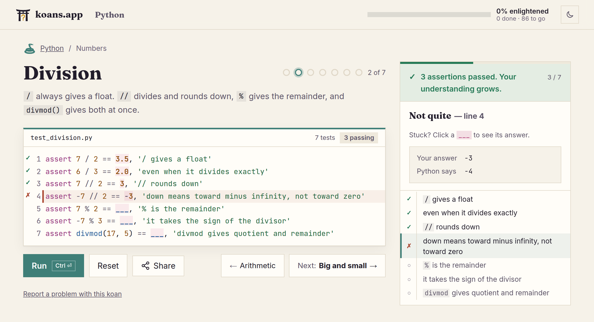

<p align="center">
  
</p>

<h1 align="center">koans.app</h1>

<p align="center">
  <strong>Learn a programming language by fixing failing tests, right in your browser.</strong>
</p>

<p align="center">
  <a href="https://koans.app"><strong>Try it at koans.app →</strong></a>
</p>

<p align="center">
  <a href="LICENSE"></a>
  <a href="LICENSE-CONTENT"></a>
</p>

<p align="center">
  <picture>
    <source media="(prefers-color-scheme: dark)" srcset=".github/readme/koan-dark.png">
    
  </picture>
</p>

**737 koans in nine languages:** JavaScript, Lua, PHP, Python, R, Raku, Ruby, SQL and TypeScript.

Each koan is a small program whose tests fail. Replace every `___` until they pass. When an
answer is wrong, the language shows you what it expected.

- **Nothing to install, no account.** Each language's real interpreter runs in your browser,
  compiled to WebAssembly. Your progress is saved there too.
- **Test-driven from the start.** The koans use each language's own testing tools (pytest, RSpec,
  PHPUnit, testthat…), so you learn the language and how to test it at the same time.
- **Works offline** once you've opened a language, and installs as an app on a phone or desktop.
- **Stuck?** Each blank can reveal its answer. Share a link to your attempt to ask for help.
- **Free and open:** the code is under the Artistic License 2.0, and the koans under CC BY-SA 4.0.

The idea comes from [Ruby Koans](https://www.rubykoans.com/). koans.app grows out of
[Raku Koans](https://hankache.github.io/raku-koans/).

## Languages

| Language                      | Koans | Interpreter                                         | Tests written with |
|-------------------------------|-------|-----------------------------------------------------|--------------------|
| [JavaScript](languages/javascript/) | 89 | the browser's own engine                      | Vitest's `expect` |
| [Lua](languages/lua/)         | 73    | [wasmoon](https://github.com/ceifa/wasmoon) (Lua 5.4) | busted's assertions |
| [PHP](languages/php/)         | 79    | [php-wasm](https://github.com/seanmorris/php-wasm) (PHP 8.5) | PHPUnit's assertions |
| [Python](languages/python/)   | 86    | [Pyodide](https://pyodide.org) (CPython 3.14)       | pytest's plain `assert`s |
| [R](languages/r/)             | 78    | [webR](https://docs.r-wasm.org/webr/latest/) (R 4.6) | testthat's expectations |
| [Raku](languages/raku/)       | 105   | [Raku++](https://github.com/ash/rakupp) (Raku.js)   | Raku's `Test`      |
| [Ruby](languages/ruby/)       | 90    | [ruby.wasm](https://github.com/ruby/ruby.wasm) (CRuby 4.0) | RSpec's `expect` |
| [SQL](languages/sql/)         | 72    | [sql.js](https://github.com/sql-js/sql.js) (SQLite 3.49) | expected rows in `-- expect:` comments |
| [TypeScript](languages/typescript/) | 65 | the TypeScript 6 compiler, then the browser's engine | Vitest's `expect` and `expectTypeOf` |

## Contributing

Found a mistake in a koan? Every koan has a **Report a problem** link that opens a filled-in
issue. To write koans, improve one, or add a language, see [CONTRIBUTING.md](CONTRIBUTING.md);
[PLAN.md](PLAN.md) has what's done and what's next.

## Running it locally

You need [Node.js](https://nodejs.org) 22.18 or newer.

```sh
npm install
npm run fetch-runtime   # downloads each language's interpreter
npm run dev             # http://localhost:5173
```

Every command, how the site works, its tests and how it's published:
[docs/DEVELOPMENT.md](docs/DEVELOPMENT.md).

## License

- **Code**, including each language's prelude, the "gateless gate" mark and the languages'
  emblems: [Artistic License 2.0](LICENSE).
- **Koans** (the koans, their solutions, and the groups' titles and blurbs):
  [CC BY-SA 4.0](LICENSE-CONTENT).
- **Third-party software** shipped in the site: [THIRD-PARTY-NOTICES.md](THIRD-PARTY-NOTICES.md).

Contributions are accepted under these same licenses: see [CONTRIBUTING.md](CONTRIBUTING.md).

The name "koans.app" and the gateless gate mark identify this project. You're welcome to reuse
the code and koans under their licenses, but please don't present a copy or fork as koans.app.
